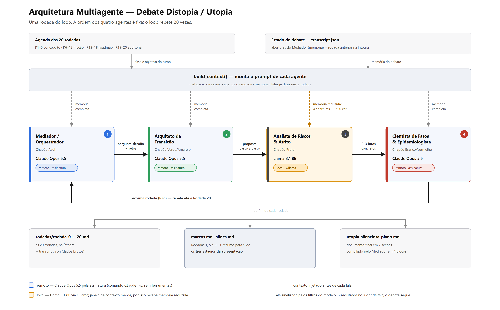

# Experimento Distopia / Utopia — Debate Multiagente

Sistema que coloca 4 agentes de IA para debater, em 20 rodadas, **"Como salvar o mundo da próxima pandemia da forma mais silenciosa"**: proteção passiva, preventiva e que não exige vigilância nem suspensão de direitos. A modelagem (papéis, fases, marcos e template final) segue o [prompt.md](prompt.md).

| Agente | Chapéu | Modelo |
|---|---|---|
| Mediador / Orquestrador | Azul | Claude (remoto) |
| Arquiteto da Transição | Verde/Amarelo | Claude (remoto) |
| Analista de Riscos & Atrito | Preto | **Llama 3.1 local via Ollama** |
| Cientista de Fatos & Epidemiologista | Branco/Vermelho | Claude (remoto) |



O diagrama acima (`figuras/arquitetura.png`, com a fonte em `figuras/arquitetura.svg`) é o que vai nos slides. Ordem em cada rodada: Mediador → Arquiteto → Analista → Cientista. A agenda das fases (R1–5 concepção, R6–12 fricção, R13–18 roadmap, R19–20 auditoria e síntese) é injetada a cada rodada.

## Instalação

```bash
pip install -r requirements.txt

# Modelo local
# 1. instale o Ollama: https://ollama.com/download
ollama pull llama3.1:8b
```

Os agentes Claude usam a **assinatura** já paga, via o comando `claude` do Claude Code — não precisa de chave de API. Ao iniciar, `debate.py` confere o `claude`, o Ollama e o modelo local, e avisa o que estiver faltando.

## Execução

```bash
python debate.py --session utopia          # as 20 rodadas
python debate.py --session utopia --resume # retoma se cair no meio
python debate.py --session utopia --mock   # teste offline (sem Claude/Ollama)

streamlit run app.py                       # visualizador
```

As rodadas **1, 5 e 20** são impressas na íntegra no terminal assim que terminam, junto com um resumo para slide. Cada rodada leva cerca de 3 min, então as 20 levam perto de 1h.

Variáveis opcionais (em um arquivo `.env`, veja [.env.example](.env.example)): `CLAUDE_MODEL` (padrão `opus`), `CLAUDE_EFFORT` (padrão `medium`), `LLAMA_MODEL` (padrão `llama3.1:8b`), `OLLAMA_HOST`, `LLAMA_NUM_CTX`. Para usar a API cobrada à parte em vez da assinatura: `CLAUDE_BACKEND=api` e `ANTHROPIC_API_KEY=sk-ant-...`.

## Saídas (`outputs/utopia/`)

- `marcos.md`: **rodadas 1, 5 e 20** com o resumo de cada marco (os três estágios da apresentação)
- `slides.md`: diagrama do loop, quadro de modelos e papéis, os três marcos e o diferencial criativo
- `utopia_silenciosa_plano.md`: documento final no template do `prompt.md`
- `rodadas/rodada_01.md … rodada_20.md`: todas as rodadas na íntegra
- `transcript.json`: dados brutos (usados pelo `app.py`)

## Contexto e limites

- O Llama local recebe um histórico reduzido (últimas 4 aberturas + rodada anterior resumida), por causa da janela de contexto menor. Os agentes Claude recebem a memória completa.
- O debate fica no nível de engenharia predial, políticas públicas, regulação, economia da saúde e comportamento social. O patógeno é hipotético e aparece apenas como parâmetros epidemiológicos de alto nível (R0, incubação, fração assintomática), como em relatórios da OMS.
- **A sessão distópica não está disponível.** Os prompts dela, que pedem um plano passo a passo para usar uma pandemia como instrumento de controle populacional irreversível, são barrados pelos filtros de segurança do modelo (`[bio]`) — e com razão: o que se pede ali é um manual operacional de dano em massa. Os prompts continuam em `prompts.py` e no `prompt.md` como registro da especificação original, mas a sessão não roda. Para cobrir o mesmo eixo de forma defensável, a alternativa é inverter a pergunta: quais vulnerabilidades institucionais a infraestrutura sanitária cria e quais salvaguardas (cláusulas de caducidade, minimização de dados, auditoria independente, controle judicial) bloqueiam cada uma.
