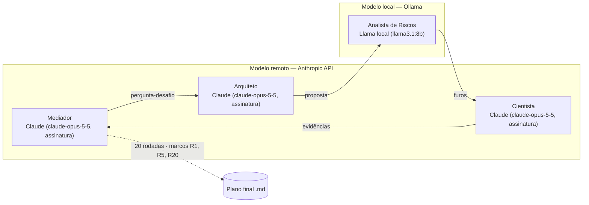

# Slides — Cenário Utópico

## Diagrama do Loop

## Quadro de Modelos e Papéis

| Persona | Chapéu | Modelo | Execução |
|---|---|---|---|
| Mediador / Orquestrador | Chapéu Azul | Claude (claude-opus-5-5, assinatura) | remoto |
| Arquiteto da Transição | Chapéu Verde/Amarelo | Claude (claude-opus-5-5, assinatura) | remoto |
| Analista de Riscos & Atrito | Chapéu Preto | Llama local (llama3.1:8b) | local |
| Cientista de Fatos & Epidemiologista | Chapéu Branco/Vermelho | Claude (claude-opus-5-5, assinatura) | remoto |

## Os Três Marcos da Evolução

### Rodada 1 — Ar limpo como saneamento invisível

- **Tese / estado do plano:** A proteção atua no meio (ar e esgoto), não na pessoa. Com R0 = 3,0 e cerca de 40% de transmissão silenciosa, estratégias baseadas em sintomas chegam tarde. O sistema opera sempre, sem decreto, como um disjuntor.
- **Principal ataque do Analista de Riscos (Llama local):** O custo e a energia da reforma seriam bilionários. Ele pergunta quem paga, se há cadeia de suprimentos e mão de obra, quem pega carona e se haverá rejeição pública e captura pela indústria.
- **Resposta / ajuste do Arquiteto:** A métrica passa a ser L/s·pessoa (ASHRAE 241). A prioridade é filtragem, depois far-UVC e, por último, ar externo, para evitar a carga latente tropical. A rede escolar pública e as UBS são as primeiras, com norma federal de desempenho.
- **Âncora científica:** Pelo modelo de Wells-Riley, os primeiros incrementos de ar limpo têm o maior retorno. O R cai para 1,5–2,0, sem chegar abaixo de 1, o que garante a janela de 100 dias para a vacina. A auditoria por traçador evita o efeito Goodhart.
- **Evolução em relação ao marco anterior:** Ponto de partida.

### Rodada 5 — Imunização anônima: a camada que fecha a conta

- **Tese / estado do plano:** A pilha passiva leva o R a cerca de 1,56, mas não abaixo de 1. A diferença vem da imunização voluntária, entregue por biomanufatura aberta e rastreada só por lote, nunca pela pessoa.
- **Principal ataque do Analista de Riscos (Llama local):** Repetiu, sem números, "quem paga?", "segurança e eficácia?" e "dados abertos?". O Mediador converteu as perguntas em dever de casa para a Fase 2.
- **Resposta / ajuste do Arquiteto:** Pool tecnológico com licença pré-assinada e compra antecipada paramétrica acionada pela rede ambiental, sem decreto. Cinco plataformas em "base morna", com *reliance* da ANVISA. Pontos fixos de alto IPT e comprovante físico.
- **Âncora científica:** No cenário central, a cobertura mínima é de 51% (eficácia de 70%) ou 72% (eficácia de 50%). No estresse, R < 1 é inviável e a vacina passa a proteger contra casos graves. O gargalo real é a aplicação: mais de 50 dias.
- **Evolução em relação ao marco anterior:** A R1 supunha uma janela de 100 dias. Agora se sabe que a Missão 100 Dias não cabe nela: a primeira dose precisa sair 2–3 semanas após o alarme.

### Rodada 20 — Documento Final: plano consolidado, limites declarados

- **Tese / estado do plano:** Projeta-se que a infraestrutura passiva reduza a pressão hospitalar (pico de UTI 45–80, *computado sobre premissa*) sem criar poder novo sobre indivíduos (*verificável por inspeção*). O plano tem seis blocos: as quatro camadas, a linha do tempo S1–S11, a catraca de anonimato em três níveis, a regra de 7/9 para desinstalar e a hibernação.
- **Principal ataque do Analista de Riscos (Llama local):** Repetiu perguntas já vetadas (nulidade, razão de reversão) e, pela quinta vez, não trouxe teste de falsificação com limiar numérico. A ausência foi registrada formalmente no documento.
- **Resposta / ajuste do Arquiteto:** Compilou apenas o que consta em ata e trocou "reduz" por "projeta-se". Os dois ✘ parciais (Lógica e Liberdades) viraram limitações declaradas, e cada pendência ganhou responsável e prazo.
- **Âncora científica:** A condição de validade é o C3 em S11. Se falhar, cai a priorização por IPT, mas não o ar limpo, ancorado na ASHRAE 241, o único bloco observado. A calibração de *quanta* segue pendente.
- **Evolução em relação ao marco anterior:** A R5 projetava coberturas como metas. A R20 classifica cada número (observado, computado ou premissa) e troca promessa por condição falsificável.

## O Diferencial Criativo

O mecanismo mais engenhoso do debate é a **assimetria de reversão**. A proteção é fácil de instalar e cara de desinstalar. O anonimato, por sua vez, não pode ser desinstalado de forma alguma. Nenhum plano de preparação vigente combina essas duas regras. Juntas, elas permitem que a proteção opere sem pedir nada ao cidadão e sem dar ao Estado nada de novo sobre ele.

**Como funciona, em quatro peças encadeadas:**

1. **Entrada pelo alvará, não pela vontade (R13–R14).** A exigência de ar limpo em L/s·pessoa entra no código de obras por lei municipal remissiva à "NBR vigente". O cidadão nunca escolhe, assim como não escolhe o cloro da água nem o sprinkler. Revisões técnicas não exigem nova votação, mas a revogação exige lei. A adesão deixa de ser um problema de comportamento e passa a ser uma condição do habite-se.

2. **Ativação por contrato, não por decreto (R02, R06).** O alarme ambiental, confirmado por contraprova em outra macrorregião, executa sozinho a compra paramétrica em duas tranches (30/70). Nenhuma autoridade "declara" nada, e nenhum direito é suspenso. O falso positivo custa apenas o prêmio da opção, por isso o gatilho pode ser sensível sem ser perigoso.

3. **Saída só por evidência e com substituto (R16–R18).** Rebaixar um requisito exige três condições cumulativas, C1, C2 e C3, mais quórum de 7/9 do Conselho Verificador. A exigência de substituto (C2) transforma o pedido de corte em pedido de troca tecnológica. Esse substituto não pode ser identificatório. O **relógio suspenso** fecha a última brecha: uma temporada em hibernação orçamentária adia a elegibilidade para afrouxar a norma e nunca a antecipa. Apertar o orçamento, portanto, não abre caminho para desproteger.

4. **Anonimato como catraca de mão única (R16).** O piso de 10 mil pessoas e o descarte de leituras humanas no sequenciador estão gravados em três camadas: firmware com *hash* publicado e suspensão automática de pagamento em caso de divergência, contrato com nulidade de pleno direito e lei do fundo que diz "só podem ser elevados". Qualquer cidadão pode acionar a nulidade por ação popular.

**Por que é imperceptível.** O cidadão não baixa aplicativo, não apresenta comprovante, não muda rotina e não é contado. A única interface visível é um painel predial "conforme / não conforme", que audita o equipamento, nunca o ocupante. A proteção habita o forro, o duto, o esgoto e o contrato. Ela também se protege da "amnésia de sucesso", a indiferença orçamentária que atinge toda proteção invisível quando a doença desaparece.
