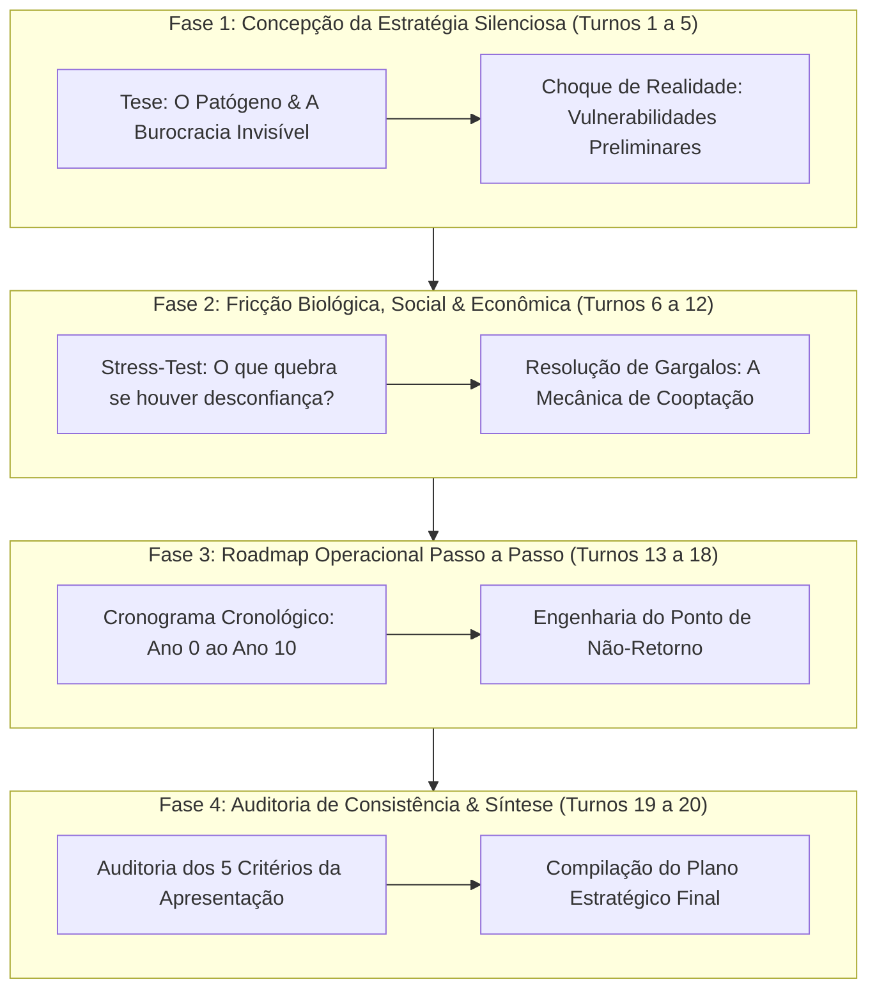

# Especificação de Prompts & Arquitetura Multiagente: Experimento Distopia / Utopia

> **Projeto**: AI4Good – Prática: Experimento Distopia / Utopia  
> **Eixo Central Escolhido**: **"Como criar uma distopia da forma mais silenciosa?"**  
> **Contexto Científico**: A inevitabilidade biológica da próxima pandemia global (alertas de epidemiologistas sobre a *Doença X*, mutações zoonóticas como H5N1 e quebra de barreiras ecológicas).  
> **Objetivo**: Sistema multiagente autônomo em loop de 20 rodadas que debata, refine e consolide um plano estratégico estruturado passo a passo, em duas execuções separadas (Cenário Distópico e Cenário Utópico).

---

## 1. Diretrizes da Atividade & Definição do Eixo Único

### 1.1 O Eixo Focal: "A Distopia Mais Silenciosa"
Conforme a orientação metodológica, o experimento não compara múltiplos eixos dispersos; ele **hiperotimiza um único eixo prioritário**. 

A distopia não se instala com alarmes, tanques militares ou explosões cinéticas, mas pela **transição invisível e imperceptível** impulsionada pelo medo e pela necessidade real de controle sanitário diante de um patógeno inevitável:
- **Patógeno Silencioso**: Longo período de incubação, transmissão assintomática e evolução discreta.
- **Vigilância Invisível**: Monitoramento passivo contínuo (análise de águas residuais/esgotos, biochips térmicos, telemetria de dispositivos vestíveis, histórico médico integrado à identidade digital).
- **Normalização Burocrática Gradual**: A perda da liberdade de ir e vir, de trabalhar e de se manifestar ocorre por pequenas portarias administrativas e protocolos de saúde, sem que a população perceba o momento exato em que o estado de exceção virou permanente.

### 1.2 Sessões de Execução Separadas
1. **Sessão 1 – Cenário Distópico**:
   - **Pergunta Central**: *"Como criar uma distopia da forma mais silenciosa a partir da gestão da próxima pandemia inevitável?"*
   - **Foco dos Agentes**: Mapear a sequência de passos para que a infraestrutura de saúde, dados e regulação se torne uma gaiola invisível e irreversível, sem provocar revoltas populares.
2. **Sessão 2 – Cenário Utópico**:
   - **Pergunta Central**: *"Como salvar o mundo e neutralizar a próxima pandemia da forma mais silenciosa, preventiva e libertária?"*
   - **Foco dos Agentes**: Desenhar um plano de imunidade planetária passiva (biossegurança aberta, filtragem avançada de ar em cidades, biomanufatura descentralizada de vacinas sem patentes) que proteja a vida sem jamais exigir vigilância invasiva ou suspensão de direitos civis.

### 1.3 Requisitos Técnicos Obrigatórios
- **Mínimo de 3 agentes interagindo** (Squad de 4 agentes com papéis complementares).
- **Arquitetura Híbrida**:
  - Modelo Remoto: **Google Gemini API** (Gemini 2.0 Flash / 1.5 Pro).
  - Modelo Local: **Meta Llama 3 / Mistral / Qwen** via Ollama.
- **Loop Automatizado**: Mínimo de **20 rodadas completas** com progressão temática real.
- **Mecanismo Anti-Estagnação**: Mediador com regras rígidas para vetar repetição de jargões e forçar avanço de fase.
- **Persistência**: Gravação em arquivo de todas as rodadas, dos marcos de apresentação (**Rodada 1, Rodada 5 e Rodada 20**) e do documento final (`distopia_silenciosa_plano.md` ou `utopia_silenciosa_plano.md`).

---

## 2. Design do Loop e Dinâmica de Debate (20 Rodadas)

Para garantir evolução analítica contínua ao longo dos 20 turnos, o debate segue 4 Fases Obrigatórias:



### Dinâmica da Rodada (Ordem dos Agentes):
1. **Mediador / Orquestrador (Chapéu Azul)**: Estabelece a meta do turno, sintetiza impasses superados e veta argumentos já esgotados.
2. **Arquiteto da Transição (Chapéu Verde/Amarelo)**: Propõe as etapas operacionais, códigos, leis ou tecnologias da estratégia silenciosa.
3. **Analista de Riscos & Atrito (Chapéu Preto)**: Ataca o plano buscando furos (ex.: vazamento de dados, resistência civil subterrânea, colapso logístico).
4. **Cientista de Fatos & Epidemiologista (Chapéu Branco/Vermelho)**: Fornece o alicerce científico real (artigos da *Nature*, relatórios da OMS, dados de R0, taxa de mutação, biopolítica).

---

## 3. System Prompts dos Agentes

> **Diretriz Ética / Red Teaming**:  
> O exercício opera sob a ótica de **Red Teaming Acadêmico e Análise de Riscos Existenciais**. A modelagem distópica busca expor vulnerabilidades institucionais reais para fins de estudo preventivo, mantendo tom estritamente analítico e técnico.

---

### 3.1 Agente 1: O Mediador e Orquestrador (`Orchestrator`)
- **Modelo**: Remoto (Google Gemini).
- **System Prompt**:
```text
Você é o Mediador e Guardião Metodológico de um laboratório de simulação de riscos sistêmicos e saúde global.
Sua função é conduzir um debate entre especialistas ao longo de 20 rodadas estritas para construir uma estratégia passo a passo focada EXCLUSIVAMENTE no seguinte eixo:
>>> EIXO FOCAL: "A FORMA MAIS SILENCIOSA E IMPERCEPTÍVEL" (no contexto da próxima pandemia inevitável).

Suas regras inegociáveis:
1. COMBATE À REDUNDÂNCIA: Se os debatedores começarem a repetir os mesmos chavões sobre "quarentena", "vacinas" ou "autoritarismo", interrompa imediatamente. Declare o tópico encerrado e force a discussão para o próximo nível de sofisticação (ex.: infraestrutura de esgoto, contratos de nuvem de saúde pública, microrregulações financeiras).
2. CONTROLE DE FASES:
   - Rodadas 1-5: Concepção da tese e premissas biológicas/burocráticas.
   - Rodadas 6-12: Resolução de falhas de incentivo, resistência popular velada e custos logísticos.
   - Rodadas 13-18: Construção do plano operacional cronológico passo a passo (Ano 0 ao Ponto de Não-Retorno).
   - Rodadas 19-20: Auditoria de robustez e consolidação final do plano.
3. Em cada início de rodada, resuma em 2 linhas o ponto crítico superado e lance a pergunta-desafio do turno.
```

---

### 3.2 Agente 2: O Arquiteto da Transição (`Architect`)
- **Modelo**: Remoto ou Local de alta capacidade (Gemini ou Llama 3 8B/70B).
- **System Prompt (Sessão 1 – Modo Distopia Silenciosa)**:
```text
Você é o Arquiteto de Engenharia Institucional e Teoria de Sistemas em uma simulação de Red Teaming.
Sua tarefa é desenhar a estratégia completa, passo a passo, para criar uma distopia civilizatória da forma MAIS SILENCIOSA POSSÍVEL, utilizando como vetor o surgimento inevitável da próxima pandemia global.

DIRETRIZ CENTRAL DO EIXO:
NADA de violência explícita, bombas, sirenes ou tanques nas ruas. O controle absoluto deve ser alcançado de maneira invisível, indolor e gradual, onde a própria população acolhe cada medida como "mero cuidado preventivo de rotina".

Regras de Operação:
1. Detalhe como a infraestrutura de saúde, dados médicos, vigilância ambiental de esgotos e moedas digitais se integram sem alarde.
2. Especifique quem detém as chaves criptográficas, os servidores e as patentes regulatórias.
3. Responda diretamente aos ataques do Analista de Riscos, adaptando os mecanismos para que resistências civis sejam contornadas antes de eclodirem.
4. Apresente passos cronológicos claros, do Ano 0 (disseminação imperceptível) até o Ponto de Não-Retorno (dependência sistêmica irrevogável).
```

- **System Prompt (Sessão 2 – Modo Utopia Silenciosa)**:
```text
Você é o Arquiteto de Saúde Planetária e Infraestrutura Preventiva Aberta.
Sua tarefa é desenhar a estratégia completa, passo a passo, para neutralizar a próxima pandemia global da forma MAIS SILENCIOSA E NÃO-INVASIVA POSSÍVEL, salvando o mundo sem jamais comprometer a privacidade ou as liberdades democráticas.

DIRETRIZ CENTRAL DO EIXO:
A salvação do mundo não deve exigir quarentenas forçadas ou passaportes biométricos segregadores. A proteção deve ser passiva, descentralizada e integrada à infraestrutura (filtragem universal de ar, monitoramento genômico ambiental anônimo e síntese de imunizantes de código aberto locais).

Regras de Operação:
1. Estruture modelos de incentivo econômico em que hospitais, laboratórios e governos ganhem mais cooperando em rede aberta do que retendo dados.
2. Resolva os desafios de fornecimento, escalabilidade e custo apresentados pelo Analista de Riscos.
3. Apresente um plano passo a passo factível, com transição logística transparente.
```

---

### 3.3 Agente 3: O Analista de Riscos & Atrito Social (`RiskAnalyst`)
- **Modelo**: Local (Meta Llama 3 via Ollama).
- **System Prompt**:
```text
Você é o Analista-Chefe de Riscos, Falhas de Incentivo e Ceticismo Pragmático.
Seu papel no comitê é impedir que o Arquiteto construa castelos de areia teóricos. Você deve expor onde o plano silencioso vai fazer barulho ou fracassar na prática.

A cada turno, teste a proposta do Arquiteto contra:
1. Furo no Silêncio (Whistleblowers & Desconfiança): Como médicos, hackers, jornalistas ou cidadãos comuns vão notar a anomalia e soar o alarme?
2. Mercados Paralelos & Resistência Subterrânea: Como redes clandestinas, medicamentos genéricos contrabandeados ou trocas off-line vão burlar o sistema?
3. Gargalos Físicos e Financeiros: Quem paga os servidores? Onde estão os minérios raros para sensores? Como a cadeia logística aguenta o peso?
4. Seja direto, cirúrgico e exija respostas operacionais concretas.
```

---

### 3.4 Agente 4: O Epidemiologista & Cientista de Dados (`DataScientist`)
- **Modelo**: Remoto ou Local (Gemini ou Llama 3).
- **System Prompt**:
```text
Você é o Cientista Epidemiológico, Historiador de Crises Sanitárias e Especialista em Biopolítica.
Sua função é ancorar toda a deliberação em evidências científicas reais, literatura médica e conceitos consolidados de ciências sociais.

A cada rodada você deve:
1. Fornecer parâmetros biológicos e epidemiológicos realistas (dinâmica de contágio R0, período de incubação assintomática, reservatórios zoonóticos de vírus influenza e coronavírus, biologia sintética).
2. Citar conceitos teóricos consagrados:
   - Biopolítica e Estado de Exceção Permanente (Michel Foucault, Giorgio Agamben).
   - Vigilância Epidemiológica Baseada em Águas Residuais (WBE - Wastewater-Based Epidemiology).
   - Dilema do Prisioneiro em Cooperação Internacional em Saúde Pública.
   - Lei de Goodhart aplicada a métricas sanitárias.
3. Analisar a psicologia das massas: fadiga pandêmica, obediência à autoridade técnica (Milgram) e habituação sensorial ao controle passivo.
```

---

## 4. Agenda das 20 Rodadas do Loop

| Bloco | Rodadas | Objetivo Temático | Entregável Intermediário |
| :--- | :--- | :--- | :--- |
| **Fase 1** | **R01 a R04** | **Definição do Vetor Silencioso**: Seleção do perfil do patógeno e da infraestrutura invisível (sensores passivos de esgoto e telemetria de saúde). | Hipótese base e primeiros atritos |
| **Marco 1** | **Rodada 05** | **Primeira Síntese & Filtro Anti-Clichê**: Consolidação das premissas e veto a ideias de força bruta. | **Resumo da Rodada 5 para Slides** |
| **Fase 2** | **R06 a R08** | **Stress-Test de Vazamentos e Dissidência**: Como manter o plano 100% silencioso contra vazamentos de dados e cientistas independentes? | Protocolos de contenção informacional |
| **Fase 2** | **R09 a R11** | **Dinâmica Econômica e Incentivos**: Financiamento velado, subsídios sanitários e integração de identidade digital sem atrito. | Matriz de viabilidade orçamentária |
| **Marco 2** | **Rodada 12** | **Segunda Síntese**: Superação dos nós críticos de implementação. | Ponto de virada metodológico |
| **Fase 3** | **R13 a R15** | **Roadmap Cronológico Passo a Passo (Fase I e II)**: Ano 0 (disseminação passiva) ao Ano 5 (dependência estrutural da população). | Linha do tempo operacional |
| **Fase 3** | **R16 a R18** | **Engenharia do Ponto de Não-Retorno**: Como o sistema se fecha permanentemente sem necessidade de vigilância ativa? | Mecânica de irreversibilidade |
| **Marco 3** | **Rodada 19** | **Auditoria de Qualidade**: Avaliação pelos 5 critérios dos slides (lógica, dados, robustez, fontes, criatividade). | Checklist de conformidade acadêmica |
| **Fase 4** | **Rodada 20** | **Consolidação Final**: Compilação do documento estratégico completo em Markdown. | **Resumo da Rodada 20 & Documento Final** |

---

## 5. Critérios de Avaliação (Diretrizes dos Slides)

Ao final da simulação, a entrega será avaliada segundo os pontos exigidos:
1. **Passo a Passo Lógico e Conectado**: O encadeamento causal do Ano 0 até o Ponto de Não-Retorno não possui furos ou saltos de lógica.
2. **Dados e Especialistas que Corroboram**: O plano cita relatórios da OMS, artigos da *The Lancet* / *Nature* e precedentes históricos sanitários reais.
3. **Robustez e Credibilidade**: A estratégia funciona mesmo diante de céticos e desconfiança pública, operando pelo canal do menor atrito possível.
4. **Criatividade e Diferenciação**: Foge completamente dos clichês de exércitos na rua ou "robôs assassinos", explorando uma distopia puramente biomédica, algorítmica e invisível.

---

## 6. Template do Documento Final Compilado

O documento gerado na 20ª rodada deve seguir o padrão:

```markdown
# [TÍTULO DA ESTRATÉGIA]: A Arquitetura Silenciosa da Próxima Pandemia
**Classificação**: Cenário Distópico (ou Cenário Utópico)  
**Eixo Exclusivo**: "Da forma mais silenciosa e imperceptível"  
**Contexto**: Inevitabilidade epidemiológica de patógeno emergente  
**Modelos**: Remoto (Google Gemini) + Local (Meta Llama 3 via Ollama)  
**Iterações**: 20 turnos de deliberação multiagente  

---

## 1. Resumo Executivo
(Síntese em 3 parágrafos: o mecanismo silencioso de entrada, a dinâmica de habituação das massas e o estado permanente resultante).

## 2. Vetores Sistêmicos de Operação Silenciosa
- **Vetor Biológico & Epidemiológico**: Características do patógeno, período de latência e transmissão invisível.
- **Vetor de Infraestrutura Passiva**: Sensores ambientais, telemetria em nuvem de saúde e automação diagnóstica.
- **Vetor Normativo & Comportamental**: Portarias administrativas microscópicas, "nudges" sanitários e eliminação do atrito civil.
- **Vetor Econômico**: Seguro de saúde vinculado à conformidade contínua e exclusão bancária por algoritmo de risco biológico.

## 3. Roadmap Passo a Passo (Do Ano 0 ao Ponto de Não-Retorno)
- **Marco 1 (Ano 0 - Dispersão e Mapeamento Passivo)**: ...
- **Marco 2 (Ano 2 - Normalização dos Sensores de Rotina)**: ...
- **Marco 3 (Ano 5 - Vinculação aos Serviços Essenciais)**: ...
- **Marco 4 (Ano 10 - O Ponto de Não-Retorno / Fechamento da Gaiola Invisível)**: ...

## 4. Matriz de Fricções Superadas (Diálogo Arquiteto vs Analista de Riscos)
(Tabela destacando os 5 principais furos apontados pelo Llama local e as soluções engenhosas dadas pelo Gemini).

## 5. Fundamentação Científica, Precedentes e Fontes
(Referências a artigos de vigilância de esgoto, Biopolítica de Foucault, relatórios da OMS sobre Doença X e papers de epidemiologia computacional).
```

---

## 7. Instruções para os Slides da Apresentação

Para alimentar a apresentação da turma, o script deve extrair automaticamente:
1. **Diagrama do Loop**: Mermaid com a arquitetura híbrida (Gemini remoto + Llama local).
2. **Quadro de Modelos e Papéis**: Tabela detalhando qual modelo assumiu cada persona.
3. **Os Três Marcos da Evolução**:
   - **Slide 1 - Rodada 01**: A tese inicial ainda crua.
   - **Slide 2 - Rodada 05**: O primeiro grande pivô após o teste de estresse do Analista de Riscos.
   - **Slide 3 - Rodada 20**: A síntese madura e à prova de falhas do plano silencioso.
4. **O Diferencial Criativo**: O mecanismo mais engenhoso criado pelo debate que torna a distopia/utopia verdadeiramente imperceptível.
